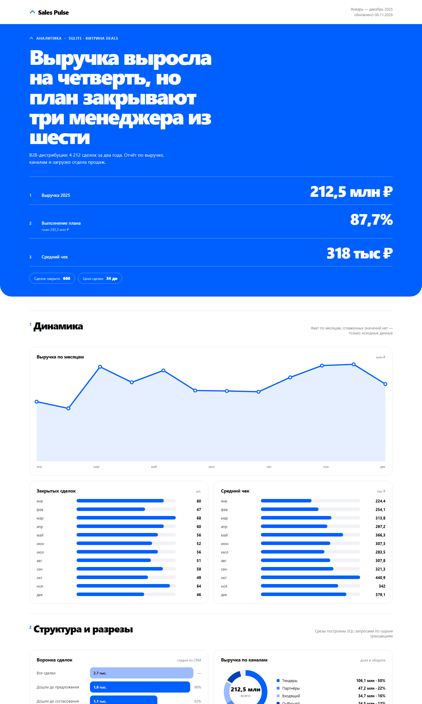
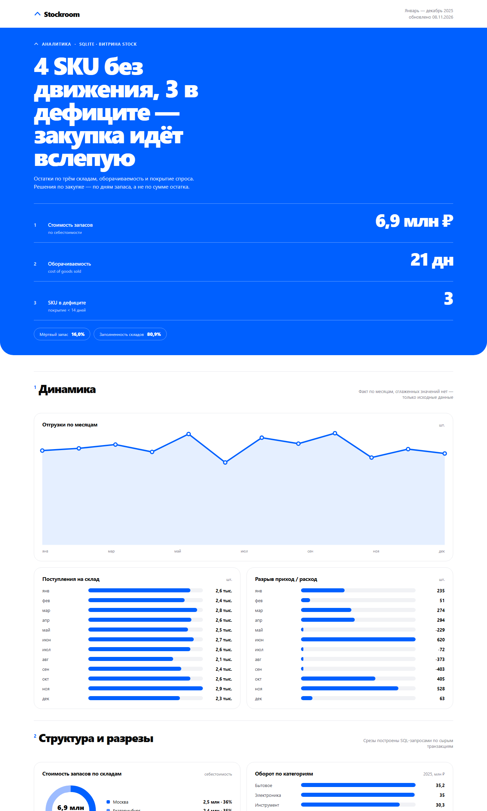
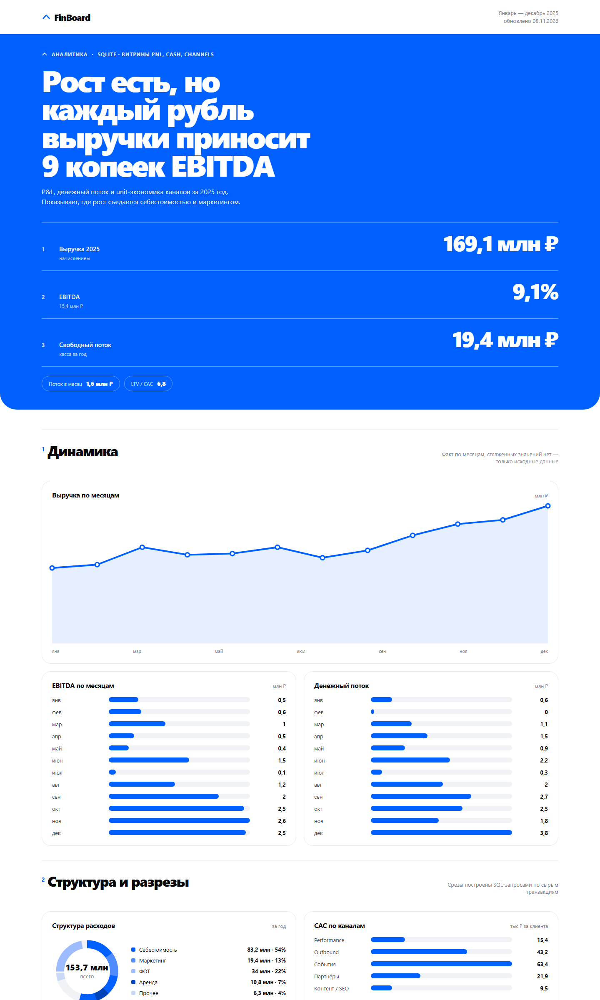
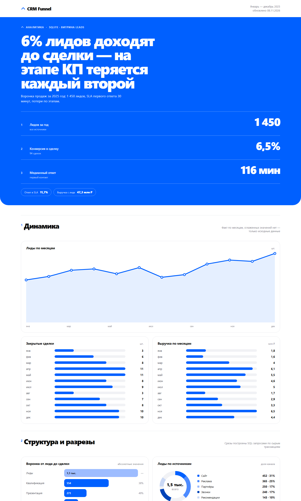
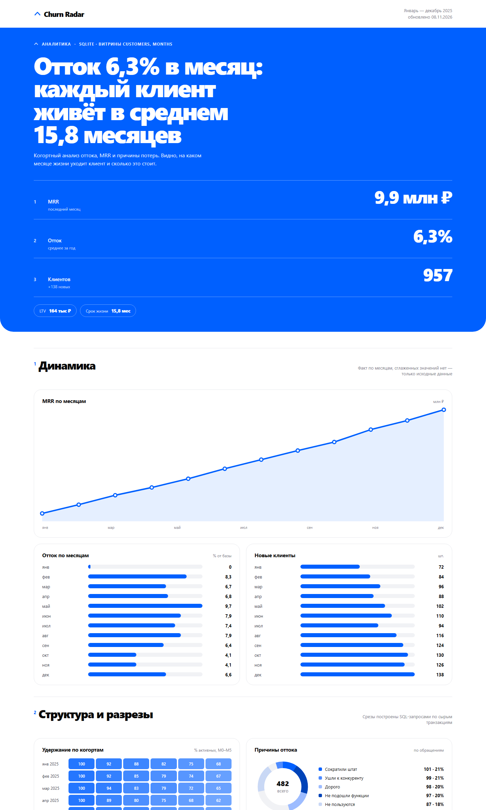
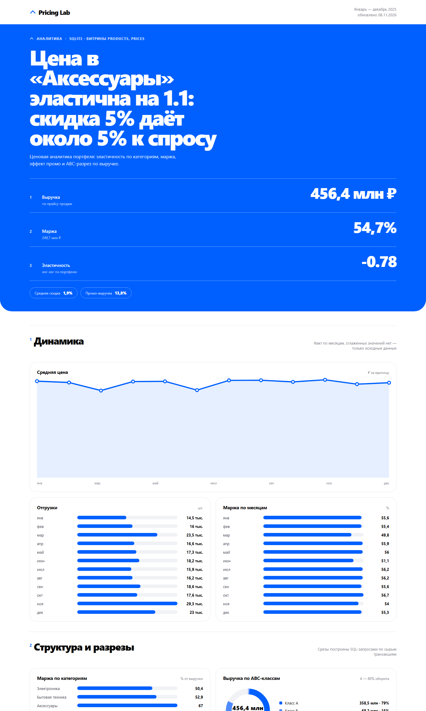

# Бизнес-портфолио: 6 full-stack дашбордов

Шесть самостоятельных проектов «бэкенд + фронтенд» вокруг бизнес-аналитики: продажи, склад, финансы, воронка, отток, цены. Данные генерируются детерминированно и живут в SQLite, аналитика считается SQL-запросами, интерфейс — React/TypeScript в стиле Циан (синий `#0060FF`, крупная типографика, тонкие разделители, номера секций).

## Стек

| Слой | Технологии |
|---|---|
| Бэкенд | Python 3.14, FastAPI, SQLite (stdlib `sqlite3`, сырой SQL, оконные функции) |
| Фронтенд | React 19, TypeScript, Vite 7, SVG-графики без сторонних библиотек |
| Качество | ESLint 9 (собственный плагин), Ruff, собственный AST-чекер |
| Инфраструктура | npm workspaces, PowerShell-скрипт запуска, портативный Node в `.tools/` |

## Проекты

| # | Проект | Порт | Что показывает |
|---|---|---|---|
| 1 | **Sales Pulse** | 8001 | выручка и план, win rate, цикл сделки, воронка, команды |
| 2 | **Stockroom** | 8002 | остатки, оборачиваемость, дни запаса, мёртвый запас, заполненность складов |
| 3 | **FinBoard** | 8003 | P&L, EBITDA, денежный поток, CAC/LTV по каналам |
| 4 | **CRM Funnel** | 8004 | лиды → сделка, конверсия по источникам, SLA первого ответа |
| 5 | **Churn Radar** | 8005 | MRR, отток, когортное удержание M0–M5, причины ухода |
| 6 | **Pricing Lab** | 8006 | эластичность спроса (лог-лог регрессия), маржа, промо, ABC-анализ |

Каждый сервис отдаёт `GET /api/dashboard` — один payload, из которого фронтенд собирает страницу, и раздаёт собранный `dist/` на `/`.

## Скриншоты

Сняты headless-браузером с запущенных сервисов, 1440 px по ширине.

### Sales Pulse — выручка, план, воронка



### Stockroom — остатки и оборачиваемость



### FinBoard — P&L и денежный поток



### CRM Funnel — воронка и SLA



### Churn Radar — отток и когорты



### Pricing Lab — эластичность и маржа



## Запуск

```powershell
# зависимости (один раз)
.\.venv\Scripts\python.exe -m pip install -r requirements.txt
npm install

# сборка всех фронтендов и запуск всех сервисов
.\run.ps1

# только запуск, без пересборки
.\run.ps1 -SkipBuild
```

Портативный Node лежит в `.tools/node-v26.13.0-win-x64` — если `node` не в PATH, добавьте его:

```powershell
$env:PATH = "$PWD\.tools\node-v26.13.0-win-x64;$env:PATH"
```

Отдельный проект:

```powershell
python -m uvicorn app.main:app --app-dir apps/sales-pulse/backend --port 8001
```

База создаётся при первом старте; чтобы пересоздать данные, удалите `apps/<проект>/backend/data/*.db`.

## Правила кода

Единый стиль для всех шести проектов, проверяется линтером, а не на словах:

- **Один выход из функции.** `return` ровно один и последним оператором; ранних выходов нет. Функция без возвращаемого значения обходится без `return`.
- **1–2 оператора в теле функции.** Роль `max-statements = 2`. Исключения — только React-хуки (`packages/ui/src/hooks/`) с лимитом 3: `useState` + `useEffect` + `return` физически не укладываются в два оператора.
- **Никаких `while`, `break`, `continue`.** Всё через `map` / `filter` / `reduce` в JS и comprehension в Python.

Проверка:

```powershell
npm run check   # ESLint + Ruff + AST-чекер + сборка
```

- `eslint.config.js` — базовые правила плюс локальный плагин `tools/eslint-plugin-style` с правилом `style/single-return` (обходит вложенные функции, считает arrow-выражения неявным `return`).
- `pyproject.toml` — Ruff с `max-returns = 1` и `max-statements = 2`.
- `tools/check_style.py` — AST-проверка того, что Ruff не покрывает: запрет `while` / `break` / `continue` и позиция `return` (разрешён внутри завершающего `with`).

## Структура

```
apps/
  sales-pulse/{backend,frontend}
  stockroom/…  finboard/…  crm-funnel/…  churn-radar/…  pricing-lab/…
packages/ui/          дизайн-система: токены, Hero, KPI, таблицы, SVG-графики
tools/                ESLint-плагин, AST-чекер
run.ps1               сборка и запуск всех сервисов
```

Бэкенд одного проекта:

```
backend/app/
  db.py        подключение, row_factory, схема, scalar/rows_of
  seed.py      детерминированная генерация данных (Random с фиксированным seed)
  queries.py   SQL-запросы и выборки
  service.py   сборка payload: KPI, серии, блоки, таблицы
  main.py      FastAPI, /api/dashboard, раздача dist
```

## Дизайн

`packages/ui` отдаёт токены (`--blue: #0060ff`, шрифт, радиусы) и компоненты: `Hero` с номерами KPI, `Section` с надстрочным индексом, `Card`, `DataTable`, `LineChart`, `BarChart`, `Donut`, `Funnel`, `Heatmap`. Графики — собственный SVG, без chart-библиотек: меньше веса и полный контроль над стилем.

## Оговорка по данным

Все цифры синтетические и сгенерированы скриптами с фиксированным seed — воспроизводимы, но не являются реальной отчётностью. Метрики в заголовках считаются из данных при каждом запросе, а не вписаны руками.
